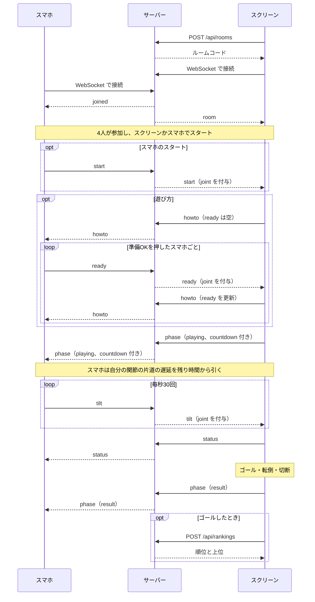

# API

スマホ・サーバー・スクリーンの間の通信の仕様。メッセージの型定義は `src/shared/` に置く。型定義を変更する PR ではこのドキュメントも合わせて変更する。

## シーケンス

1回のプレイのメッセージの流れ。



サーバーはルームごとに1つの Durable Object。物理演算は行わず、メッセージを中継する。ランキングは、全体で1つの別の Durable Object に保存する。

## エンドポイント

| エンドポイント | クライアント | 説明 |
|---|---|---|
| `GET /screen` | スクリーン | スクリーンのページ |
| `GET /play?room=<ルームコード>` | スマホ | スマホのページ。QR コードの URL |
| `POST /api/rooms` | スクリーン | ルームを作成する |
| `GET /api/rooms/<ルームコード>/ws` | スクリーン、スマホ | WebSocket で接続する |
| `POST /api/rankings` | スクリーン | ゴールしたタイムをランキングに保存する |
| `GET /api/rankings?mode=<モード>` | スクリーン | ランキングの上位を取得する |

### POST /api/rooms

ルームを作成する。リクエストボディは無い。レスポンスはルームコード（英数字4文字）。

ルームコードに使う文字は、大文字の英字と数字から、読み間違えやすい `0`・`O`・`1`・`I`・`L` を除いた31文字。小文字で指定されても大文字として扱う。作ったコードがすでにあるルームと重なったときは、作り直す。10回作っても重なるときは、503 を返す。

```json
{ "roomCode": "K7Q2" }
```

作りすぎを防ぐため、次のときは 429 を返し、ルームを作らない（理由は[設計](design.md)の「ルームを作る API の乱用」）。レスポンスの `reason` が理由。`Retry-After` ヘッダーに、また作れるようになるまでの秒数が付く。

| `reason` | いつ | `Retry-After` |
|---|---|---|
| `too-many-requests` | 同じ IP から、1分に10回を超えて呼んだ。Cloudflare のロケーションごとに数えるので、厳密ではない | 60 |
| `daily-limit` | その日（日本時間の朝9時から次の朝9時まで）に作ったルームが200に届いた。本番とプレビューは別に数える | 次の朝9時までの秒数 |

```json
{ "reason": "daily-limit" }
```

- 先に `too-many-requests` を調べる。断ったときは、その日の数に入れない
- スクリーンは、理由に合った文を出す（「今日はもう作れません。日本時間の朝9時に戻ります」など）

### GET /api/rooms/&lt;ルームコード&gt;/ws

WebSocket で接続する。クエリパラメータ `role` に、スクリーンは `screen`、スマホは `phone` を指定する。スマホは、クエリパラメータ `client` に自分の ID を付けられる（「スマホの ID と関節の予約」を参照）。接続後、スマホは `joined` か `rejected` を、スクリーンは `room` か `rejected` を受信する。サーバーが `phase` を保持していれば、スマホは `joined` のあと、スクリーンは `room` のあとに、最後の `phase` を受信する。遊び方の間なら、スマホは最後の `howto` も受信する。スマホは、`joined`・`phase`（保持していれば）・`howto`（保持していれば）・`room` の順に受信する。スマホに送るときは、カウントダウンの残り時間を計算し直す（「phase」を参照）。

- ルームが無いとき、スマホもスクリーンも `rejected`（`no-room`）を受信し、接続が閉じる
- プレイ中（サーバーが最後に受信した `phase` が `playing`）のとき、スマホは `rejected`（`playing`）を受信し、接続が閉じる。`phase` が `result` か `lobby` に変わると、また参加できる。ただし、戻ってきたスマホ（下の「スマホの ID と関節の予約」）は断らない
- 満員（4つの関節が、接続中のスマホか予約で埋まっている）のとき、スマホは `rejected`（`full`）を受信し、接続が閉じる。スマホは順番待ちの画面を出し、自動でつなぎ直す。`playing` のときも同じ
- スマホを断る理由は、`no-room`・`playing`・`full` の順に調べる。戻ってきたスマホは、ルームがあれば `playing`・`full` を調べずに受け付ける
- 途中で参加したスマホは、受信した `phase` でルームの状態に合った画面を表示できる。同じルームにつなぎ直したスクリーンは、プレイの途中だったかを知れる
- スクリーンはルームに1つだけ。2つ目のスクリーンが接続すると、古いスクリーンの接続を閉じて、新しいスクリーンに置き換える。切れたスクリーンは、同じルームにつなぎ直せる（プレイ中だったときはロビーに戻る）。ページを開き直すと新しいルームを作る
- `role` が `screen`・`phone` のどちらでもなければ、400 を返す

サーバーが接続を閉じるときの close コード：

| コード | 意味 |
|---|---|
| `4000` | 新しいスクリーンに置き換えた。スマホは、同じ ID の新しい接続に置き換えた |
| `4001` | 参加を断った（`rejected` を送ったあと） |
| `4002` | ハートビートもメッセージも15秒届かなかった（`heartbeat` を参照） |
| `4004` | スマホの「抜ける」を受け付けた（`left` を送ったあと） |

```
wss://<ホスト名>/api/rooms/K7Q2/ws?role=phone&client=3f2b9c1e-8a4d-4e6f-9b0a-1c2d3e4f5a6b
```

#### スマホの ID と関節の予約

切れたスマホが同じ関節に戻れるように、サーバーは関節を予約しておく。

- `client` は、スマホが決める ID。英数字と `-` の1〜64文字（`crypto.randomUUID()` の形が収まる）。形が合わなければ、付いていないものとして扱う
- `client` の無いスマホは、予約の対象にならない。切れると関節はすぐ空きになる
- `client` のあるスマホが切れると（close・エラー・`4002`）、サーバーはその関節を、ID と一緒に60秒とっておく（予約）
- 「抜ける」で抜けたスマホの関節は予約しない
- 同じ ID のスマホが60秒以内につなぎ直すと、予約していた関節を渡す
- 同じ ID の古い接続がまだ開いている（サーバーがまだ古い接続を閉じていない）ときにつなぎ直すと、古い接続を close コード `4000` で閉じ、同じ関節を新しい接続に渡す。関節は `room` の `joints` から抜けない
- 予約が無く、同じ ID の古い接続が閉じかけで、サーバーがまだその切断を処理していない（予約をまだ作っていない）ときも、古い接続の関節を新しい接続に渡す。古い接続の切断は処理しない（予約を作らない）
- ほかのスマホの開いた接続が持っている関節は、予約しない。予約や閉じかけの接続があっても、ほかのスマホの開いた接続がその関節を持っていれば、無いものとして扱う（切断の処理が遅れたときに、2台が同じ関節にならないように）。閉じかけの接続の関節を、ほかの ID が予約していれば、それも渡さない
- 予約か、開いた接続か、切断を処理していない閉じかけの接続のある ID のスマホを「戻ってきたスマホ」と呼ぶ。プレイ中でも断らない
- ほかのスマホには、予約されている関節を渡さない。予約されていない空きの関節を、参加順の順番で渡す。無ければ `full` で断る
- 予約している関節は、`room` の `joints` に入らない。`joints` は接続中のスマホの関節だけ
- 60秒を過ぎた予約は、関節を割り当てるときに無いものとして扱う。予約を消すためのアラームは置かない
- ルームを消すと、予約も消える

### POST /api/rankings

ゴールしたタイムをランキングに保存する。スクリーンが、ゴールしたとき（`phase` の `result.outcome` が `goal`）に送る。日時はサーバーが付ける。リクエストボディは JSON。型定義は `src/shared/api.ts` の `SubmitRankingRequest`。

| フィールド | 型 | 説明 |
|---|---|---|
| `mode` | `string` | モード。現在は `10m` のみ |
| `teamName` | `string` | チーム名。下の決まりで整えて保存する |
| `timeMs` | `number` | ゴールまでの時間（ミリ秒）。`phase` の `result.timeMs` をそのまま送る |

```json
{ "mode": "10m", "teamName": "ふにゃーず", "timeMs": 32500 }
```

- チーム名は、NFKC で正規化し（全角の英数字と空白を半角にする）、前後の空白を除いてから調べる。1〜10文字（絵文字や濁点の付いた文字も1文字と数える）。改行・タブなどの制御文字と、文字の向きを変える文字や幅のない空白などの書式の文字（Unicode の `Cf`）は使えない。ただし絵文字をつなぐ ZWJ（U+200D）は使える。空白と見えない文字（ZWJ や異体字セレクタなど）だけの名前は断る。整える前で100文字（UTF-16 のコード単位で数える）を超えるものと、孤立したサロゲートを含むものも断る
- タイムは整数のミリ秒に丸める。1ミリ秒〜1時間（3,600,000ミリ秒）を受け付ける。制限時間は設けないので（Issue #81）、1時間は明らかにおかしな値を断るためだけの上限
- 形や範囲が合わないときは、400 と理由の文字列を返し、保存しない
- 同じ IP から、1分に5回を超えて呼ぶと、429 と `{ "reason": "too-many-requests" }` を返し、保存しない。`Retry-After` は 60。Cloudflare のロケーションごとに数えるので、厳密ではない。値の検査で断ったもの（400）は、回数に入れない（理由は[設計](design.md)の「ランキング」）。型定義は `src/shared/api.ts` の `TooManyRequests`
- 保存したら 201 を返す。`entry` は保存した1件と順位、`rankings` は保存したあとの上位（`GET /api/rankings` と同じ形）。結果の画面は、これだけで順位と上位を出せる

```json
{
  "entry": { "rank": 3, "teamName": "ふにゃーず", "timeMs": 32500, "createdAt": 1795771597498 },
  "rankings": [
    { "rank": 1, "teamName": "FUNYA", "timeMs": 28000, "createdAt": 1795771597510 }
  ]
}
```

### GET /api/rankings?mode=&lt;モード&gt;

ランキングの上位10件を、速い順に返す。型定義は `src/shared/api.ts` の `RankingsResponse`。`mode` が無いか `10m` でなければ、400 を返す。

```json
{ "mode": "10m", "rankings": [{ "rank": 1, "teamName": "FUNYA", "timeMs": 28000, "createdAt": 1795771597510 }] }
```

| フィールド | 型 | 説明 |
|---|---|---|
| `rank` | `number` | 順位（1から） |
| `teamName` | `string` | 整えたあとのチーム名 |
| `timeMs` | `number` | タイム（ミリ秒、整数） |
| `createdAt` | `number` | 保存した時刻（Unix 時間のミリ秒） |

- 同じタイムは、先に保存したものを上にする。順位は並べた順の番号で、同じタイムでも同じ順位にはしない
- モードごとに1,000件まで残す。超えたら、いちばん遅いもの（同じタイムなら後に保存したもの）から消す
- 1,000位より下は残らない。POST が `rank` 1001 以上を返した記録は、保存した直後に消えている
- データはプレビューと本番で分かれる（[設計](design.md) の「ランキング」）
- 同じチーム名でも、別の記録として保存する（チームごとにまとめない）。残す件数の上限は同じく効く
- 自動ではリセットしない。発表の直前に、シーズン（Durable Object の名前）を変えて空にする（[設計](design.md) の「ランキング」）

## メッセージ

メッセージは JSON で送る。種類は `type` フィールドで区別する。

サーバーは受信したメッセージを検証する。送信元が送れないメッセージ・形の違うメッセージは、何も返さずに捨てる。

| メッセージ | 送信元 → 送信先 | 到達保証 |
|---|---|---|
| `joined` | サーバー → スマホ | 必要 |
| `rejected` | サーバー → スクリーン、スマホ | 必要 |
| `room` | サーバー → スクリーン、すべてのスマホ | 必要 |
| `phase` | スクリーン → サーバー → すべてのスマホ。接続したときは、サーバー → スマホ・スクリーン | 必要 |
| `howto` | スクリーン → サーバー → すべてのスマホ。遊び方の間に接続したときは、サーバー → スマホ。新しいスマホに準備OK 済みの関節を渡したときは、サーバー → スクリーン、スマホ | 必要 |
| `ready` | スマホ → サーバー → スクリーン | 必要 |
| `start`、`retry` | スマホ → サーバー → スクリーン | 必要 |
| `leave` | スマホ → サーバー | 必要 |
| `left` | サーバー → スマホ | 必要 |
| `tilt` | スマホ → サーバー → スクリーン | 不要 |
| `status` | スクリーン → サーバー → すべてのスマホ | 不要 |
| `ping`、`pong` | スクリーン ⇄ スマホ | 不要 |
| `heartbeat` | スクリーン、スマホ ⇄ サーバー | 不要 |
| `close-room` | スクリーン → サーバー | 必要 |
| `room-closed` | サーバー → スクリーン、すべてのスマホ | 必要 |

到達保証が不要なメッセージは繰り返し送るもの。1つ失われても次のメッセージで回復する。WebRTC DataChannel に移すのはこの種類だけ。

### joined

ルームに参加できた。

| フィールド | 型 | 説明 |
|---|---|---|
| `joint` | `Joint` | 担当の関節。`rightHip`・`leftHip`・`rightKnee`・`leftKnee` のいずれか |

```json
{ "type": "joined", "joint": "rightHip" }
```

### rejected

ルームに参加できなかった。

| フィールド | 型 | 説明 |
|---|---|---|
| `reason` | `string` | `full`：満員。`playing`：プレイ中。`no-room`：ルームが無い |

```json
{ "type": "rejected", "reason": "full" }
```

### room

ルームの参加者が変わった。

| フィールド | 型 | 説明 |
|---|---|---|
| `roomCode` | `string` | ルームコード |
| `joints` | `Joint[]` | 接続中のスマホが担当する関節。4つそろうと開始できる。予約しているだけの関節は入らない |
| `vacated` | `Joint`（省略可） | 「抜ける」で空いた関節。抜けたときに送る `room` にだけ付ける。予約していないので、スクリーンはこの関節をつなぎ直しを待つ席ではなく、空きの席として扱える |

```json
{ "type": "room", "roomCode": "K7Q2", "joints": ["rightHip", "leftHip"] }
```

```json
{ "type": "room", "roomCode": "K7Q2", "joints": ["rightHip"], "vacated": "leftHip" }
```

### phase

ルームの状態が変わった。

| フィールド | 型 | 説明 |
|---|---|---|
| `phase` | `string` | `lobby`：ロビー。`playing`：カウントダウンかプレイ中。`result`：結果 |
| `mode` | `string` | `playing` のときだけ。現在は `10m` のみ |
| `countdown` | `object` | `playing` のときだけ。無ければプレイ中 |
| `countdown.kind` | `string` | `count` は「3・2・1、GO!」、`readyGo` は「よーい、ドン！」 |
| `countdown.durationMs` | `number` | カウントダウンの長さ。`count` は3000ms、`readyGo` は1500ms |
| `countdown.remainingMs` | `number` | 送信時点で開始までに残っている時間（ミリ秒） |
| `countdown.delayMs` | `Partial<Record<Joint, number>>` | 関節ごとの片道の遅延（ミリ秒、0以上の整数）。計測できていない関節は省く |
| `result.outcome` | `string` | `result` のときだけ。`goal`：ゴール。`fell`：転倒。`disconnected`：切断（切れたスマホが60秒の予約のうちにつなぎ直さなかった） |
| `result.distanceM` | `number` | 進んだ距離（m）。後ろに進むと負の値 |
| `result.timeMs` | `number` | ゴールまでの時間（ミリ秒）。`goal` のときだけ |

```json
{ "type": "phase", "phase": "playing", "mode": "10m",
  "countdown": { "kind": "count", "durationMs": 3000, "remainingMs": 3130,
                 "delayMs": { "rightHip": 42, "leftKnee": 130 } } }
{ "type": "phase", "phase": "playing", "mode": "10m" }
{ "type": "phase", "phase": "result", "result": { "outcome": "goal", "distanceM": 10, "timeMs": 32500 } }
```

- スクリーンはカウントダウンを始めるとき、`delayMs` に、その時点で分かっている `ping`・`pong` の片道の遅延を入れる。中央値を使い、無ければ直近の値を使う
- スクリーンは、`delayMs` のいちばん大きい値（1000ms まで）だけ待ってから、最初の表示（「3」「よーい」）を出す。`remainingMs` は、その待つ時間に `durationMs` を足した値。待たないと、遅いスマホは `phase` が届くまで最初の表示を出せず、そのぶん遅れる
- `durationMs` と `remainingMs` は、どちらも0〜10000の有限の数を受け付ける
- サーバーはこの `phase` をそのままスマホに中継する。サーバーの受信時刻に `remainingMs` を足し、カウントダウンの終了時刻として `phase` とともに保存する。ほかの `phase` が届いたら、保存した終了時刻を消す
- スマホは、`remainingMs` から自分の関節の `delayMs`（0〜1000ms に収め、値が無ければ0）を引き、受信時刻に足して開始時刻を決める。`durationMs` と開始までの時間から、いまの表示を選ぶ。開始時刻から `durationMs` を引いた時刻（最初の表示）より前は、数字を出さない。開始時刻を過ぎて届いたときは、すぐにプレイ中の画面を出す。受信してからの時間をスマホ自身の時計で数えるので、端末どうしで時計を合わせる必要はない

### howto

遊び方の間であることと、準備OKを受け取った関節を知らせる。遊び方の間も `phase` は `lobby` のまま。

| フィールド | 型 | 説明 |
|---|---|---|
| `ready` | `Joint[]` | スクリーンが準備OKを受け取った関節 |

```json
{ "type": "howto", "ready": [] }
{ "type": "howto", "ready": ["rightHip"] }
```

- スクリーンは、遊び方を始めたときに空の `ready` を送る。そのあとは `ready` が変わるたびと、つなぎ直したときに送る。つなぎ直しているあいだに届かなかった `ready` は、スマホが送り直す（「ready」を参照）
- スクリーンは、遊び方を終えるとき（カウントダウンに進む、待ち受けに戻る）に、`phase` を送る
- サーバーは最後の `howto` を保持し、すべてのスマホに中継する。あとから接続したスマホにも送る
- サーバーは、遊び方の間に、戻ってきたスマホでない新しいスマホに関節を渡したとき、保持している `ready` からその関節を外す。外した `howto` を保持し、スクリーンとそのスマホに送る。前の人が押した準備OK を、新しく席に入った人に引き継がないため。スクリーンは、関節が `room` の `joints` から抜けても `ready` から外さず、サーバーから届いた `howto` の `ready` に置き換える。席に入ったのが同じスマホかを知っているのは、サーバーだけのため
- サーバーは、スクリーンから `phase` を受け取ったときやルームを終了するときに `howto` を消す
- スマホは、`phase` が `lobby` のときだけ `howto` を受け付ける。カウントダウンや結果のあとに遅れて届いたものは捨てる

### ready

スマホで準備OKを押した。

| フィールド | 型 | 説明 |
|---|---|---|
| `joint` | `Joint` | サーバーがスクリーンに中継するときに、接続に割り当てた関節を付ける |

```json
{ "type": "ready" }
{ "type": "ready", "joint": "rightHip" }
```

上がスマホの送信、下がスクリーンの受信。

- サーバーはルームの状態にかかわらず中継する。スマホが `joint` を付けていても、接続に割り当てた関節で上書きする
- スマホは、遊び方の間に準備OKを押したあと、`howto` の `ready` に自分の関節が無ければ送り直す。スクリーンは同じ関節を1回だけ数える

### start、retry

スタート・もう一度のボタンを押した。

| フィールド | 型 | 説明 |
|---|---|---|
| `joint` | `Joint` | サーバーがスクリーンに中継するときに付与する。スマホは送らない |

```json
{ "type": "start" }
{ "type": "start", "joint": "rightHip" }
```

```json
{ "type": "retry" }
{ "type": "retry", "joint": "rightHip" }
```

それぞれ上がスマホの送信、下がスクリーンの受信。

- スクリーンは、4人そろっているときだけ受け付ける
- `start` はロビー、`retry` は結果のときだけ受け付け、ほかの状態で届いたものは捨てる
- 2台がほぼ同時に押しても、2つめはカウントダウンの間に届くので捨てる
- サーバーは状態を見ずに中継する（状態はスクリーンが決める）
- スマホは、4人そろっていないときはボタンを押せなくする

### leave、left

待機か結果の画面で「抜ける」を押すと、スマホはサーバーに `leave` を送る。サーバーは `phase` を見ずに受け付ける。

```json
{ "type": "leave" }
{ "type": "left" }
```

- サーバーは関節をすぐ空ける。予約は作らない。スクリーンと残りのスマホに `vacated` を付けた `room` を送る。そのあと、抜けたスマホに `left` を送り、理由 `left`、コード `4004` で閉じる
- スマホは `left` か `4004` を受け取って、おわり（P7）を表示する。つなぎ直さない
- スマホはボタンを押した直後に接続を閉じない。サーバーが `leave` を受け取る前に切断を処理すると、関節を予約してしまうため
- サーバーは、閉じかけの接続から届いた `leave` も、切断を処理する前なら受け付ける。押した直後にタブを閉じたときも予約しない。閉じかけの接続の関節がもう別のスマホに渡っていれば、`vacated` は付けない
- 受け付けの返事を待つあいだに切れたら、つなぎ直す。`joined` が届いたら `leave` を送り直し、`rejected` が届いたら抜けたものとして扱う。60秒のうちにつなぎ直せなかったときも、抜けたものとして扱う（サーバーの予約も同じころに切れる）
- スマホがボタンを出すのは待機と結果のときだけ。サーバーは状態を見ないので、カウントダウンやプレイ中に届いた `leave` も受け付ける

### tilt

スマホの傾き。

| フィールド | 型 | 説明 |
|---|---|---|
| `seq` | `number` | シーケンス番号。受信側は受信済みの番号より小さいものを破棄する |
| `angle` | `number` | 傾きの角度（度）。0 が水平、90 が手前に立てた状態 |
| `joint` | `Joint` | サーバーがスクリーンに中継するときに付与する。スマホは送らない |

```json
{ "type": "tilt", "seq": 128, "angle": 42 }
{ "type": "tilt", "seq": 128, "angle": 42, "joint": "rightHip" }
```

上がスマホの送信、下がスクリーンの受信。

- スマホは、`deviceorientation` の `beta` を0〜90に収めて `angle` にする
- スマホは、参加しているあいだは、`phase` によらず、角度が変わらなくても毎秒約30回送る。スクリーンは、直近0.5秒に `tilt` が届いたかで入力の状態（`status`）を決めるため
- シーケンス番号はスマホごとに数える。スクリーンは関節ごとに比べる
- スクリーンは、`room` の `joints` から抜けた関節の番号を忘れる。その関節に次に入ったスマホは、番号を小さい値から数え始めてよい

### status

入力の状態。

| フィールド | 型 | 説明 |
|---|---|---|
| `active` | `Joint[]` | スクリーンが直近0.5秒の間に `tilt` を受信した関節 |

```json
{ "type": "status", "active": ["rightHip", "leftKnee"] }
```

- スクリーンは、`active` が変わったときに送る。変わらなくても、1秒に1回送る
- `phase`（`result` 以外）を送った直後にも送る。スマホは `phase` を受け取ると、入力の状態を消すため
- 結果（`result`）のあいだは送らない

### ping、pong

遅延の計測。スクリーンが `ping` を送信し、スマホが同じ `id` の `pong` を返す。スクリーンは往復時間の半分を片道の遅延とする。WebSocket のプロトコルが持つ ping・pong フレームとは別のもの。

スクリーンは、つながっている関節（最後に受け取った `room` の `joints`）ごとに、1秒に1回 `ping` を送る。スマホは、受け取ったらすぐに `pong` を返す。返すのは共通のクライアント（`src/net/client.ts` の `connectPhone`）で、スマホのページは何もしなくてよい。数秒たっても `pong` が返らない `ping` は、スクリーンが忘れる。スクリーンは、`id` をページを開いた時刻（ミリ秒）から数え始め、`pong` の `id` と `joint` が送った `ping` と同じものだけを使う。前に開いたスクリーンのページへの `pong` を取り違えないため。

サーバーは `ping` を `joint` のスマホにだけ送る。その関節のスマホが接続していなければ捨てる。

| フィールド | 型 | 説明 |
|---|---|---|
| `id` | `number` | 計測の番号 |
| `joint` | `Joint` | `ping` では宛先のスマホ。`pong` ではサーバーがスクリーンに中継するときに付与する |

```json
{ "type": "ping", "id": 7, "joint": "rightHip" }
{ "type": "pong", "id": 7 }
```

### heartbeat

接続が生きていることを知らせる。スマホもスクリーンも、接続しているあいだ5秒ごとに送る。サーバーは同じ文字列をそのまま返す。中継はしない。

| フィールド | 型 | 説明 |
|---|---|---|
| `type` | `string` | `heartbeat` のみ。ほかのフィールドは無い |

```json
{"type":"heartbeat"}
```

- 空白を入れず、上の文字列のとおりに送る。1文字でも違うと、サーバーは返さない
- サーバーは、ランタイムの機能で自動で返す。ハートビートのたびには、ルームの Durable Object は起きない
- ハートビートもほかのメッセージも15秒届かない接続を、サーバーは close コード `4002` で閉じる。切断と同じに扱い、スマホの関節は空きになる（`client` のあるスマホなら予約する）。接続した直後の15秒は閉じない
- 最後にハートビートかメッセージが届いてから、15秒で閉じる。数秒遅れることがある
- ほかのメッセージを送っていても、ハートビートは止めない。サーバーが休止から戻ると、ほかのメッセージを受信した時刻は分からなくなり、ハートビートの時刻で判断する
- クライアントは、ハートビートの返事もほかのメッセージも10秒届かなければ、切れたとみなして接続を閉じ、つなぎ直す（「つなぎ直し」を参照）。ハートビートは5秒ごとなので、返事が1回遅れただけでは切らない。サーバーの15秒より早く気づける
- つなぎ始めてから10秒たっても開かないときも、切れたとみなす

## つなぎ直し

スマホもスクリーンも、思いがけず切れたら、同じルームに同じ URL で自動でつなぎ直す（`src/net/connection.ts`）。

- 待つ時間は、1秒・2秒・4秒・8秒、そのあとは10秒ごと。スクリーンは、時間では諦めない。断られずにメッセージを受け取れたら、次に切れたときは1秒から待ち直す
- 参加していたスマホは、60秒のうちに `joined` を受け取れなければ、つなぎ直しをやめて接続終了の画面にする。60秒は、最後につながっていてページが動いていた時刻から数え、`joined` を受け取るまでに何回切れても数え直さない。ふつうは、サーバーの予約（「スマホの ID と関節の予約」）より先に切れる。画面のロックなどでページが止まっていたときに、戻った時刻から数えると、予約が切れたあとにつなぎ直してしまうため
  - 60秒を過ぎたら、新しい接続を開かない。予約が切れたあとにつなぐと、新しいスマホとして別の関節を取ることがあり、閉じるとその関節を60秒予約させてしまう
  - 60秒になったときに開いている途中の接続は、切らずに結果を待つ。サーバーが関節を返したあとに切ると、その関節をまた60秒予約させてしまう。その接続が切れたら、つなぎ直さない
  - `joined` を受け取ったら、60秒を数えるのをやめる。そのあと `room` を受け取るまで、つなぎ直しの画面を出したままにする。`phase` と `howto` は、サーバーが保持していれば `room` より先に届く
  - 参加する前に断られて（`full`・`playing`）順番待ちをしているスマホは、時間では諦めない。参加していたスマホは、つなぎ直しで断られても、この60秒で諦める
- 初めの接続がつながらなかったときも、同じようにつなぎ直す
- タブが表に戻ったとき（`visibilitychange`）に、つなぎ直すのを待っていれば、待たずにすぐつなぎ直す。待つ時間も1秒からに戻す
- スマホは、タブごとに `crypto.randomUUID()` で作った ID を `sessionStorage` に覚え、接続の URL に `client=<ID>` として付ける（`phoneClientId()`）。同じタブで読み込み直しても同じ ID になる。ブラウザでタブを複製すると `sessionStorage` も写るので、2つのタブが同じ ID になる。そのときは、あとからつないだタブが前のタブを置き換える（`4000`）
- スマホの `tilt` のシーケンス番号は、ページを開いた時刻（ミリ秒）から数え始める（`createTiltSeq()`）。読み込み直しても、前の番号より必ず大きくなる。毎秒30しか増えないので、時計を追い越さない
- スクリーンは、関節ごとの受信済みのシーケンス番号を、抜けた関節のぶんは `room` を受け取ったときに忘れ、つなぎ直したら全部忘れる。切れているあいだに関節の担当が入れ替わると、その関節は `room` から一度も抜けないことがあるため
- スクリーンは、つなぎ直したら、遅延の計測（関節ごとの値と、返事を待っている `ping`）を全部忘れる。理由はシーケンス番号と同じ
- スマホがつなぎ直したとき、サーバーは保存したカウントダウンの終了時刻から現在時刻を引く。残りが0より大きければ、ミリ秒の値を整数に丸めて `countdown.remainingMs` に入れ、ほかのフィールドはそのまま送る。スマホは再送でも同じ遅延を引く。保存した終了時刻には、最初のメッセージがスクリーンからサーバーに届くまでの時間も含まれるため。残りが0以下なら、`countdown` を省いた `phase`（`playing`）を送る。スクリーンには保存した `phase` をそのまま送る
- プレイ中に切れたスクリーンは、つなぎ直して `phase`（`playing`）を受け取ったら、`phase`（`lobby`）を送り直す。プレイを途中から続けることはしない。ただし、結果の画面を出していれば（切れていて `phase`（`result`）を送れなかったとき）、`phase`（`result`）を送り直す

閉じ方ごとのクライアントの動き：

| 閉じ方 | つなぎ直すか |
|---|---|
| こちらから閉じた（`close()`） | つなぎ直さない |
| `rejected`（`no-room`）を受け取ったあと、`4001` で閉じた | つなぎ直さない |
| `rejected`（`full`・`playing`）を受け取ったあと、`4001` で閉じた | つなぎ直す。結果かロビーで席が空いていれば入れる |
| `4000`（新しい接続に置き換えた。スクリーン、または同じ `client` のスマホ） | つなぎ直さない。つなぎ直すと、新しい接続を置き換え返してしまう |
| `room-closed` または `4003`（ルームを終了した） | つなぎ直さない。スマホはおわり（P7）を表示する |
| `left` または `4004`（「抜ける」を受け付けた） | つなぎ直さない。スマホはおわり（P7）を表示する |
| `4002`（ハートビートが届かなかった）、そのほか | つなぎ直す |
| 返事が10秒届かず、こちらから閉じた | つなぎ直す |
| 参加していたスマホが、60秒のうちに `joined` を受け取れなかった | つなぎ直さない。こちらから閉じる（`1000`） |

接続の状態（`ConnectionState`）は、`connecting`（初めてつないでいる）・`open`（つながっている）・`reconnecting`（つなぎ直している。`attempt` は何回目か）・`closed`（もうつなぎ直さない。`code` は close コード、こちらから閉じたときは `1000`）のいずれか。

## ルームの終了

スクリーンは `{"type":"close-room"}` を送って、ルームを終了できる。スマホから同じメッセージを送っても捨てる。

- サーバーは終了した印をストレージに残し、`phase`・`howto`・関節の予約・削除の予定を消す。終了したコードは再利用せず、以後のスマホ・スクリーンの接続は `rejected`（`no-room`）で断る
- 終了を記録したあと、スクリーンとすべてのスマホに `{"type":"room-closed"}` を送り、close コード `4003`、理由 `room-closed` で接続を閉じる。スクリーンにとっては終了の受け付けの返事になる
- クライアントは通知だけでもハートビートと再接続を止める。通知が届かず `4003` だけが届いた場合も再接続せず終了する。閉じる際にスマホの関節を60秒予約しない
- つなぎ直し中で通知を受け取れなかったスマホは、次の接続を `no-room` で断られるので、再接続を止めてルームが無い旨を表示する
- 終了した印は10分の自動削除の対象にしない。運営が作り直す場合は、新ルームを作って接続を確認してから、旧ルームを終了する

## ルームの削除

サーバーは、終了していないルームのうち、誰も接続していないものを10分後に消す。

- 全員の接続が切れてから10分後に消す。10分のあいだに誰かが接続すると、消すのをやめる
- 作ってから誰も接続しないルームも、作ってから10分後に消す
- 消すと、ルームコードと保持している `phase` も消える。そのルームコードに接続すると `rejected`（`no-room`）を受信する
- プレイ中にスクリーンが切れても、`phase` は消さない。ルームを消すときに一緒に消す

## 設計方針

| 方針 | 理由 |
|---|---|
| ルームの状態はスクリーンが決める。サーバーは最後に受信した状態を保持する | ゴールや転倒を判定できるのは、物理演算を行うスクリーンだけ |
| `tilt` は差分ではなく現在の値を送る | 1つ失われても次のメッセージで回復する |
| `tilt` にシーケンス番号を付け、受信側で古いものを破棄する | WebRTC では順序が入れ替わって届くことがある |
| 到達保証が必要なメッセージと不要なメッセージを分ける | WebRTC を追加するとき、不要なものだけを移せる |
| メッセージの形式をトランスポート（WebSocket・WebRTC）から分離する | トランスポートを追加しても、メッセージを変更しなくて済む |
| `tilt` の `joint` はサーバーが付与する | スマホが担当を偽れない |
| 角度は度のまま送り、関節の目標角度への変換はスクリーンで行う | 調整する値をスクリーンの定数に集約できる |
| 担当の関節は参加順に `rightHip`・`leftHip`・`rightKnee`・`leftKnee` を割り当てる。切断した関節は空きになり、次の参加者に割り当てる。ただし、`client` のあるスマホの関節は60秒予約する（下の行） | 4つの関節が重複せずに埋まる |
| `client` のあるスマホが切れたら、関節を60秒予約し、同じ ID のスマホに渡す | 一瞬切れただけで担当が入れ替わらない。「同じ4人・同じ担当」でやり直せる。60秒は、Wi-Fi の途切れ・画面のロック・アプリの切り替えに足り、本当にいなくなった人の関節を長く空けたままにしない |
| 予約の期限は、関節を割り当てるときに調べる | アラームを増やさない。期限を過ぎた予約が残っていても、割り当てのときに無いものとして扱えば困らない |
| 同じ ID の古い接続が開いていれば、`4000` で閉じて置き換える | サーバーが古い接続を閉じる前に戻れたときも、すぐに入れる。関節が `room` から抜けないので、プレイ中ならプレイが続く |
| 同じ ID の古い接続が閉じかけで、まだ切断を処理していなければ、その関節を渡す | 切断を処理する前は予約がまだ無い。そのまま空きの関節を渡すと、すぐに戻れたのに担当が入れ替わる |
| 戻ってきたスマホは、プレイ中でも断らない | 新しく参加するのではなく、同じ担当に戻るだけなので、「プレイの途中で担当が変わらない」に反しない |
| ID を確かめない | ID を知っていれば、ほかの人がその関節を横取りできる。ハッカソンでは問題にしない |
| プレイ中は参加を受け付けない | プレイの途中で担当が変わらない |
| 接続したスマホとスクリーンに、最後の `phase` を送る。スマホ向けのカウントダウンは残り時間を更新する | 途中で参加したスマホと、同じルームにつなぎ直したスクリーンが、ルームの状態を知れる。カウントダウン中に戻ったスマホは、残り時間に合う表示から再開できる |
| プレイ中にスクリーンが切れても、サーバーは `phase` を変えない | 状態はスクリーンが決める。同じルームにつなぎ直したスクリーンが、受け取った `phase` を見て決める（今は、プレイ中だったら `lobby` を送り直す。「つなぎ直し」を参照）。新しいルームを作ったときは、古いルームは誰もいなくなって10分たつと消える |
| 切れた接続は、ハートビートが届かなくなったことで見分ける | 画面のロックや電波切れでは、close が届かない。関節を持ったまま残ると、次の人が参加できない |
| ハートビートはサーバーのランタイムが自動で返す | ハートビートのたびに Durable Object を起こさない |
| 切れた接続を調べるのと、ルームを消すのは、1つのアラームで行う | アラームは Durable Object のリクエストとして数え、起きている時間も課金される。接続があるあいだは、いちばん古い接続が期限を迎える時刻だけに置く（およそ10〜15秒ごと）。誰もいないルームは消す時刻の1回だけ、消したルームには置かない |
| `tilt` の送信は毎秒30回から始める | 遅延と通信量を計測してから決める |
| 受信したメッセージは検証してから使う | TypeScript の型は実行時には検査されない |
| ランキングへの保存は、スクリーンが HTTP で送る。サーバーは `phase` を見て自動で保存しない | 状態はスクリーンが決める。チーム名はスクリーンでしか入力できず、ゴールの `phase` とは別の時点で決まる |
| `POST /api/rankings` は、保存したあとの上位も返す | 結果の画面が、順位と上位を1回のリクエストで出せる。Durable Objects のリクエストを1回減らせる |
