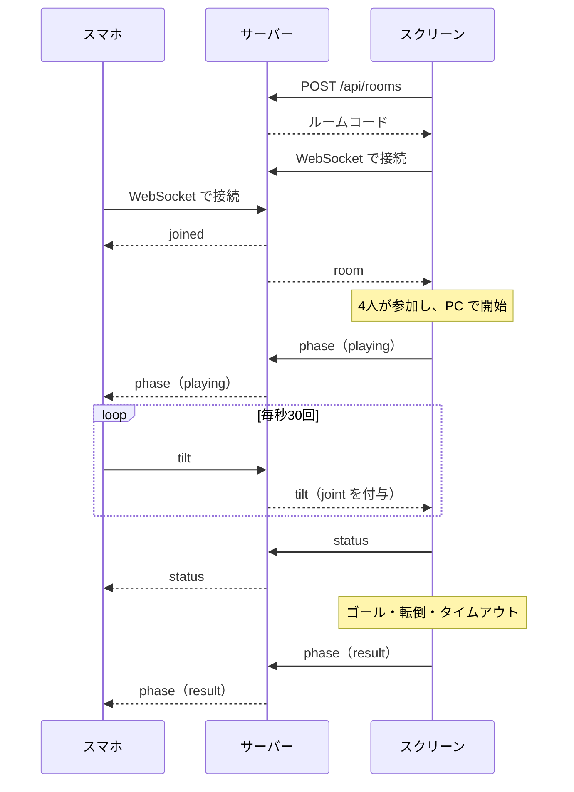

# API

スマホ・サーバー・スクリーンの間の通信の仕様。メッセージの型定義は `src/shared/` に置く。型定義を変更する PR ではこのドキュメントも合わせて変更する。

## シーケンス

1回のプレイのメッセージの流れ。



サーバーはルームごとに1つの Durable Object。物理演算は行わず、メッセージを中継する。

## エンドポイント

| エンドポイント | クライアント | 説明 |
|---|---|---|
| `GET /screen` | スクリーン | スクリーンのページ |
| `GET /play?room=<ルームコード>` | スマホ | スマホのページ。QR コードの URL |
| `POST /api/rooms` | スクリーン | ルームを作成する |
| `GET /api/rooms/<ルームコード>/ws` | スクリーン、スマホ | WebSocket で接続する |
| `GET /api/rankings` | スクリーン | ランキングを取得する（Should。仕様はランキングの実装時に決める） |

### POST /api/rooms

ルームを作成する。リクエストボディは無い。レスポンスはルームコード（英数字4文字）。

ルームコードに使う文字は、大文字の英字と数字から、読み間違えやすい `0`・`O`・`1`・`I`・`L` を除いた31文字。小文字で指定されても大文字として扱う。作ったコードがすでにあるルームと重なったときは、作り直す。10回作っても重なるときは、503 を返す。

```json
{ "roomCode": "K7Q2" }
```

### GET /api/rooms/&lt;ルームコード&gt;/ws

WebSocket で接続する。クエリパラメータ `role` に、スクリーンは `screen`、スマホは `phone` を指定する。スマホは、クエリパラメータ `client` に自分の ID を付けられる（「スマホの ID と関節の予約」を参照）。接続後、スマホは `joined` か `rejected` を、スクリーンは `room` か `rejected` を受信する。サーバーが `phase` を保持していれば、スマホは `joined` のあと、スクリーンは `room` のあとに、最後の `phase` を受信する。

- ルームが無いとき、スマホもスクリーンも `rejected`（`no-room`）を受信し、接続が閉じる
- プレイ中（サーバーが最後に受信した `phase` が `playing`）のとき、スマホは `rejected`（`playing`）を受信し、接続が閉じる。`phase` が `result` か `lobby` に変わると、また参加できる。ただし、戻ってきたスマホ（下の「スマホの ID と関節の予約」）は断らない
- 満員（4つの関節が、接続中のスマホか予約で埋まっている）のとき、スマホは `rejected`（`full`）を受信し、接続が閉じる
- スマホを断る理由は、`no-room`・`playing`・`full` の順に調べる。戻ってきたスマホは、ルームがあれば `playing`・`full` を調べずに受け付ける
- 途中で参加したスマホは、受信した `phase` でルームの状態に合った画面を表示できる。同じルームにつなぎ直したスクリーンは、プレイの途中だったかを知れる
- スクリーンはルームに1つだけ。2つ目のスクリーンが接続すると、古いスクリーンの接続を閉じて、新しいスクリーンに置き換える。切れたスクリーンが同じルームにつなぎ直すと、続けられる。スクリーンのページを開き直すと、新しいルームを作る
- `role` が `screen`・`phone` のどちらでもなければ、400 を返す

サーバーが接続を閉じるときの close コード：

| コード | 意味 |
|---|---|
| `4000` | 新しいスクリーンに置き換えた。スマホは、同じ ID の新しい接続に置き換えた |
| `4001` | 参加を断った（`rejected` を送ったあと） |
| `4002` | ハートビートもメッセージも15秒届かなかった（`heartbeat` を参照） |

```
wss://<ホスト名>/api/rooms/K7Q2/ws?role=phone&client=3f2b9c1e-8a4d-4e6f-9b0a-1c2d3e4f5a6b
```

#### スマホの ID と関節の予約

切れたスマホが同じ関節に戻れるように、サーバーは関節を予約しておく。

- `client` は、スマホが決める ID。英数字と `-` の1〜64文字（`crypto.randomUUID()` の形が収まる）。形が合わなければ、付いていないものとして扱う
- `client` の無いスマホは、予約の対象にならない。切れると関節はすぐ空きになる
- `client` のあるスマホが切れると（close・エラー・`4002`）、サーバーはその関節を、ID と一緒に60秒とっておく（予約）
- 同じ ID のスマホが60秒以内につなぎ直すと、予約していた関節を渡す
- 同じ ID の古い接続がまだ開いている（サーバーがまだ切れたことに気づいていない）ときにつなぎ直すと、古い接続を close コード `4000` で閉じ、同じ関節を新しい接続に渡す。関節は `room` の `joints` から抜けない
- 予約か開いた接続のある ID のスマホを「戻ってきたスマホ」と呼ぶ。プレイ中でも断らない
- ほかのスマホには、予約されている関節を渡さない。予約されていない空きの関節を、参加順の順番で渡す。無ければ `full` で断る
- 予約している関節は、`room` の `joints` に入らない。`joints` は接続中のスマホの関節だけ
- 60秒を過ぎた予約は、関節を割り当てるときに無いものとして扱う。予約を消すためのアラームは置かない
- ルームを消すと、予約も消える

## メッセージ

メッセージは JSON で送る。種類は `type` フィールドで区別する。

サーバーは受信したメッセージを検証する。送信元が送れないメッセージ・形の違うメッセージは、何も返さずに捨てる。

| メッセージ | 送信元 → 送信先 | 到達保証 |
|---|---|---|
| `joined` | サーバー → スマホ | 必要 |
| `rejected` | サーバー → スクリーン、スマホ | 必要 |
| `room` | サーバー → スクリーン、すべてのスマホ | 必要 |
| `phase` | スクリーン → サーバー → すべてのスマホ。接続したときは、サーバー → スマホ・スクリーン | 必要 |
| `tilt` | スマホ → サーバー → スクリーン | 不要 |
| `status` | スクリーン → サーバー → すべてのスマホ | 不要 |
| `ping`、`pong` | スクリーン ⇄ スマホ | 不要 |
| `heartbeat` | スクリーン、スマホ ⇄ サーバー | 不要 |

到達保証が不要なメッセージは繰り返し送るもの。1つ失われても次のメッセージで回復する。WebRTC DataChannel に移すのはこの種類だけ。

### joined

ルームに参加できた。

| フィールド | 型 | 説明 |
|---|---|---|
| `joint` | `Joint` | 担当の関節。`rightHip`・`leftHip`・`rightKnee`・`leftKnee` のいずれか |

```json
{ "type": "joined", "joint": "rightHip" }
```

### rejected

ルームに参加できなかった。

| フィールド | 型 | 説明 |
|---|---|---|
| `reason` | `string` | `full`：満員。`playing`：プレイ中。`no-room`：ルームが無い |

```json
{ "type": "rejected", "reason": "full" }
```

### room

ルームの参加者が変わった。

| フィールド | 型 | 説明 |
|---|---|---|
| `roomCode` | `string` | ルームコード |
| `joints` | `Joint[]` | 接続中のスマホが担当する関節。4つそろうと開始できる。予約しているだけの関節は入らない |

```json
{ "type": "room", "roomCode": "K7Q2", "joints": ["rightHip", "leftHip"] }
```

### phase

ルームの状態が変わった。

| フィールド | 型 | 説明 |
|---|---|---|
| `phase` | `string` | `lobby`：ロビー。`playing`：プレイ中。`result`：結果 |
| `mode` | `string` | `playing` のときだけ。現在は `10m` のみ |
| `result.outcome` | `string` | `result` のときだけ。`goal`：ゴール。`fell`：転倒。`timeout`：タイムアウト。`disconnected`：切断 |
| `result.distanceM` | `number` | 進んだ距離（m）。後ろに進むと負の値 |
| `result.timeMs` | `number` | ゴールまでの時間（ミリ秒）。`goal` のときだけ |

```json
{ "type": "phase", "phase": "playing", "mode": "10m" }
{ "type": "phase", "phase": "result", "result": { "outcome": "goal", "distanceM": 10, "timeMs": 32500 } }
```

### tilt

スマホの傾き。

| フィールド | 型 | 説明 |
|---|---|---|
| `seq` | `number` | シーケンス番号。受信側は受信済みの番号より小さいものを破棄する |
| `angle` | `number` | 傾きの角度（度）。0 が水平、90 が手前に立てた状態 |
| `joint` | `Joint` | サーバーがスクリーンに中継するときに付与する。スマホは送らない |

```json
{ "type": "tilt", "seq": 128, "angle": 42 }
{ "type": "tilt", "seq": 128, "angle": 42, "joint": "rightHip" }
```

上がスマホの送信、下がスクリーンの受信。

- シーケンス番号はスマホごとに数える。スクリーンは関節ごとに比べる
- スクリーンは、`room` の `joints` から抜けた関節の番号を忘れる。その関節に次に入ったスマホは、番号を小さい値から数え始めてよい

### status

入力の状態。

| フィールド | 型 | 説明 |
|---|---|---|
| `active` | `Joint[]` | スクリーンが直近0.5秒の間に `tilt` を受信した関節 |

```json
{ "type": "status", "active": ["rightHip", "leftKnee"] }
```

### ping、pong

遅延の計測。スクリーンが `ping` を送信し、スマホが同じ `id` の `pong` を返す。スクリーンは往復時間の半分を片道の遅延とする。WebSocket のプロトコルが持つ ping・pong フレームとは別のもの。

サーバーは `ping` を `joint` のスマホにだけ送る。その関節のスマホが接続していなければ捨てる。

| フィールド | 型 | 説明 |
|---|---|---|
| `id` | `number` | 計測の番号 |
| `joint` | `Joint` | `ping` では宛先のスマホ。`pong` ではサーバーがスクリーンに中継するときに付与する |

```json
{ "type": "ping", "id": 7, "joint": "rightHip" }
{ "type": "pong", "id": 7 }
```

### heartbeat

接続が生きていることを知らせる。スマホもスクリーンも、接続しているあいだ5秒ごとに送る。サーバーは同じ文字列をそのまま返す。中継はしない。

| フィールド | 型 | 説明 |
|---|---|---|
| `type` | `string` | `heartbeat` のみ。ほかのフィールドは無い |

```json
{"type":"heartbeat"}
```

- 空白を入れず、上の文字列のとおりに送る。1文字でも違うと、サーバーは返さない
- サーバーは、ランタイムの機能で自動で返す。ハートビートのたびには、ルームの Durable Object は起きない
- ハートビートもほかのメッセージも15秒届かない接続を、サーバーは close コード `4002` で閉じる。切断と同じに扱い、スマホの関節は空きになる（`client` のあるスマホなら予約する）。接続した直後の15秒は閉じない
- 最後にハートビートかメッセージが届いてから、15秒で閉じる。数秒遅れることがある
- ほかのメッセージを送っていても、ハートビートは止めない。サーバーが休止から戻ると、ほかのメッセージを受信した時刻は分からなくなり、ハートビートの時刻で判断する

## ルームの削除

サーバーは、誰も接続していないルームを10分後に消す。

- 全員の接続が切れてから10分後に消す。10分のあいだに誰かが接続すると、消すのをやめる
- 作ってから誰も接続しないルームも、作ってから10分後に消す
- 消すと、ルームコードと保持している `phase` も消える。そのルームコードに接続すると `rejected`（`no-room`）を受信する
- プレイ中にスクリーンが切れても、`phase` は消さない。ルームを消すときに一緒に消す

## 設計方針

| 方針 | 理由 |
|---|---|
| ルームの状態はスクリーンが決める。サーバーは最後に受信した状態を保持する | ゴールや転倒を判定できるのは、物理演算を行うスクリーンだけ |
| `tilt` は差分ではなく現在の値を送る | 1つ失われても次のメッセージで回復する |
| `tilt` にシーケンス番号を付け、受信側で古いものを破棄する | WebRTC では順序が入れ替わって届くことがある |
| 到達保証が必要なメッセージと不要なメッセージを分ける | WebRTC を追加するとき、不要なものだけを移せる |
| メッセージの形式をトランスポート（WebSocket・WebRTC）から分離する | トランスポートを追加しても、メッセージを変更しなくて済む |
| `tilt` の `joint` はサーバーが付与する | スマホが担当を偽れない |
| 角度は度のまま送り、関節の目標角度への変換はスクリーンで行う | 調整する値をスクリーンの定数に集約できる |
| 担当の関節は参加順に `rightHip`・`leftHip`・`rightKnee`・`leftKnee` を割り当てる。切断した関節は空きになり、次の参加者に割り当てる | 4つの関節が重複せずに埋まる |
| `client` のあるスマホが切れたら、関節を60秒予約し、同じ ID のスマホに渡す | 一瞬切れただけで担当が入れ替わらない。「同じ4人・同じ担当」でやり直せる。60秒は、Wi-Fi の途切れ・画面のロック・アプリの切り替えに足り、本当にいなくなった人の関節を長く空けたままにしない |
| 予約の期限は、関節を割り当てるときに調べる | アラームを増やさない。期限を過ぎた予約が残っていても、割り当てのときに無いものとして扱えば困らない |
| 同じ ID の古い接続が開いていれば、`4000` で閉じて置き換える | サーバーが切れたことに気づく前に戻れたときも、すぐに入れる。関節が `room` から抜けないので、プレイ中の短い切断ならプレイが続く |
| 戻ってきたスマホは、プレイ中でも断らない | 新しく参加するのではなく、同じ担当に戻るだけなので、「プレイの途中で担当が変わらない」に反しない |
| ID を確かめない | ID を知っていれば、ほかの人がその関節を横取りできる。ハッカソンでは問題にしない |
| プレイ中は参加を受け付けない | プレイの途中で担当が変わらない |
| 接続したスマホとスクリーンに、最後の `phase` を送る | 途中で参加したスマホと、同じルームにつなぎ直したスクリーンが、ルームの状態を知れる。スクリーンが接続のたびに `phase` を送り直す案もあるが、送り忘れるとスマホが止まる |
| プレイ中にスクリーンが切れても、サーバーは `phase` を変えない | 状態はスクリーンが決める。同じルームにつなぎ直したスクリーンは、受け取った `phase` から続けるか、`lobby` を送り直して始め直す。新しいルームを作ったときは、古いルームは誰もいなくなって10分たつと消える |
| 切れた接続は、ハートビートが届かなくなったことで見分ける | 画面のロックや電波切れでは、close が届かない。関節を持ったまま残ると、次の人が参加できない |
| ハートビートはサーバーのランタイムが自動で返す | ハートビートのたびに Durable Object を起こさない |
| 切れた接続を調べるのと、ルームを消すのは、1つのアラームで行う | アラームは Durable Object のリクエストとして数え、起きている時間も課金される。接続があるあいだは、いちばん古い接続が期限を迎える時刻だけに置く（およそ10〜15秒ごと）。誰もいないルームは消す時刻の1回だけ、消したルームには置かない |
| `tilt` の送信は毎秒30回から始める | 遅延と通信量を計測してから決める |
| 受信したメッセージは検証してから使う | TypeScript の型は実行時には検査されない |
